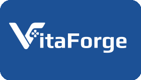

<div align="center">
  

  # VitaForge

  **A modern homebrew catalog browser, installer and plugin manager for the PlayStation Vita.**

  [](LICENSE)
  [](https://vitasdk.org/)
  [](https://www.rust-lang.org/)
  [](https://github.com/josephinoo/vitaForge/releases)

  [Features](#features) · [Install](#installation) · [Roadmap](#roadmap) · [Build](#building-from-source) · [Credits](#credits--acknowledgments)

</div>

---

## Overview

**VitaForge** is a native Rust app for the PS Vita that lets you browse the homebrew catalog, install apps, games and plugins, and keep everything up to date, all from the console, with a gamepad- and touch-friendly UI.

## Features

- **Catalog browsing**: search and filter by name, author, category, platform or rating, with sorting and featured rails.
- **Installed app detection**: knows what is already on your console and flags outdated versions.
- **Reliable installs**: homebrew, PSP, PS1 and Vita content with progress reporting, ZIP verification and permission-safe extraction.
- **Plugin installation**: installs plugins and registers them with taiHEN.
- **Screenshots & media**: fast, cached icons and screenshots.
- **Requirement alerts**: warns when a title needs extra data files or plugins.
- **Self-update**: checks for new releases on startup and updates itself.
- **Themes & languages**: 20 color palettes and multi-language UI, with an in-app on-screen keyboard.

## Installation

1. Download **`VitaForge.vpk`** from the [latest release](https://github.com/josephinoo/vitaForge/releases/latest).
2. Copy it to your Vita with VitaShell (USB or FTP).
3. Install it in VitaShell and launch **VitaForge** from the LiveArea.

## Roadmap

### Install & downloads
- [ ] Hash verification of everything downloaded.
- [ ] Download queue with pause, resume and retry.
- [ ] More robust parallel downloads.
- [ ] Better PSP, PS1 and extra game data support.
- [ ] "Update all" in one action.

### Plugins
- [ ] Plugin registry: id, version, source and target titles.
- [ ] Safe `ur0:tai/config.txt` editing with a backup before every change.
- [ ] Adopt plugins that were installed by hand.
- [ ] Plugins section: enable, disable, reorder and remove.
- [ ] Per-title and global load scopes (`*KERNEL`, `*main`, `TITLEID`).
- [ ] Update detection and one-tap updates.
- [ ] Dependency and conflict warnings.
- [ ] Plugin catalog with description, screenshots, compatibility and changelog.
- [ ] Profiles, export / import and a safe mode that disables all plugins.

### Catalog & discovery
- [ ] Combined filters, search history and suggestions.
- [ ] Favorites and wishlist.
- [ ] "New" and "Recently updated" sections.
- [ ] Configurable catalog sources.

> Roadmap items are plans, not promises, and may change. Ideas and feedback are welcome via [issues](https://github.com/josephinoo/vitaForge/issues) and [CONTRIBUTING.md](CONTRIBUTING.md).

## Building from Source

Requirements: [VitaSDK](https://vitasdk.org/) and [cargo-vita](https://github.com/vita-rust/cargo-vita) on Rust nightly.

```bash
# Build the VPK package
make vpk

# Install directly to a PS Vita over FTP
make ftp VITA_IP=192.168.0.x
```

<details>
<summary>Technical notes</summary>

- **Stack:** SDL2 (input / audio) + egui (UI) + [vitaGL](https://github.com/Rinnegatamante/vitaGL) (GPU), using precompiled shaders, so `libshacccg.suprx` is not required.
- **Vita3K:** vitaGL splash symbols are stubbed at link time to avoid emulator crashes.
- **Logs:** `ux0:data/vitaforge/vitaforge.log`.

</details>

## Credits & Acknowledgments

- **[Rinnegatamante](https://github.com/Rinnegatamante)** for [VitaDB](https://vitadb.rinnegatamante.it/), [VitaDB-Downloader](https://github.com/Rinnegatamante/VitaDB-Downloader) and [vitaGL](https://github.com/Rinnegatamante/vitaGL).
- The **vita-rust** team for the Rust toolchain for PS Vita.
- **[Northfear](https://github.com/Northfear)** for the SDL2 + vitaGL integration patterns.

## Contributors

Thanks to everyone who contributes to VitaForge ❤️

<a href="https://github.com/josephinoo/vitaForge/graphs/contributors"></a>

## License

Distributed under the [GPL-3.0 License](LICENSE).
